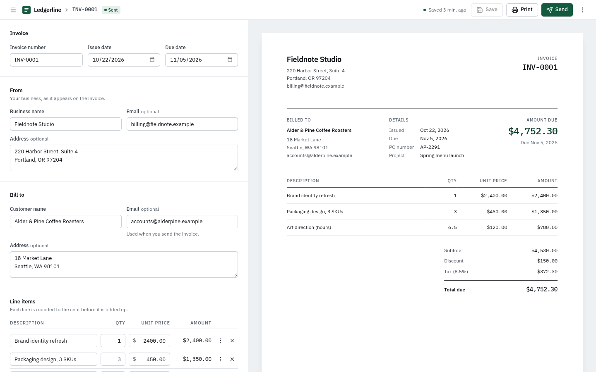

# Ledgerline Invoices

Invoice generator for small businesses: edit on the left, live preview on the right, then save, print or email it as a PDF.



## Features

- Invoice editor with line items, discount, tax, payment terms, notes and custom fields (show/hide, reorder)
- Live US Letter preview; printing or the emailed PDF contains only the invoice
- Invoice list with server-side search, status filters, sorting and pagination
- Lifecycle: Draft, Sent, Paid, Overdue. Paid invoices are locked; edits after sending prompt a resend
- Saved customers with autocomplete
- Email over SMTP with the invoice attached as a PDF
- Undo for deleted invoices (soft delete), keyboard shortcuts (`?` lists them), responsive down to phones

## Run it

Requires Python 3.11+, [uv](https://docs.astral.sh/uv/), Node 20+ and Pango (for PDFs; `brew install pango` on macOS).

```bash
cd backend
cp .env.example .env
uv sync
uv run uvicorn app.main:app --reload --port 8000
```

```bash
cd frontend
npm install
npm run dev        # http://localhost:5173
```

Data is stored in SQLite (`backend/invoices.db`, created on first start). For demo data: `uv run python -m app.seed --count 40`.

## Email

Set the SMTP values in `backend/.env` and restart the backend. Any provider works, for example:

| Provider | Host | Port | Security |
| --- | --- | --- | --- |
| Gmail (app password) | `smtp.gmail.com` | 587 | `starttls` |
| Resend | `smtp.resend.com` | 465 | `ssl` |
| Local test server | `127.0.0.1` | 1025 | `none` |

For the local server: `uvx --from aiosmtpd python -m aiosmtpd -n -l 127.0.0.1:1025`.

## Totals

Each line is rounded to the cent, then summed; the fixed discount comes off the subtotal; tax is calculated on the remainder and rounded. So `2 × $50 - $10 + 10% = $99.00`. The same rules run in `frontend/src/features/invoice/money.ts` (for the preview) and `backend/app/services/money.py` (the source of truth). No floats anywhere.

## Structure

```
.
├── backend/
│   ├── app/
│   │   ├── api/            # routes and dependency wiring
│   │   ├── core/           # config, database, errors
│   │   ├── models/         # SQLAlchemy tables
│   │   ├── schemas/        # Pydantic request and response models
│   │   ├── repositories/   # queries
│   │   ├── services/       # business rules, money, email, PDF
│   │   ├── templates/      # email and PDF templates
│   │   ├── seed.py
│   │   └── main.py
│   └── tests/
└── frontend/
    └── src/
        ├── components/     # UI primitives and app shell
        ├── features/       # invoice editor, preview, list, shortcuts
        ├── hooks/
        ├── lib/            # API client (types generated from OpenAPI), query setup
        ├── pages/
        └── main.tsx
```

## Tests

```bash
cd backend && uv run pytest
cd frontend && npm test && npm run typecheck && npm run lint
```
## Time spent

About 3 hours.

## Not done yet

- Partial payments and overdue reminders
- Authentication and multiple businesses
- Postgres with Alembic migrations, deployment
- End-to-end tests (Playwright)
- Per-line tax, other currencies, logo upload
