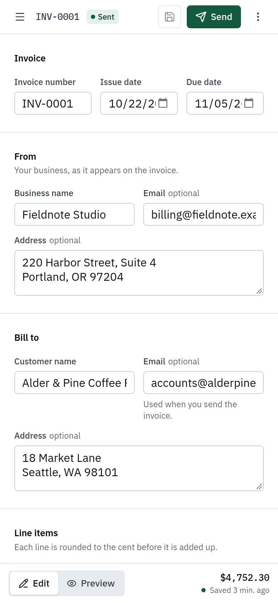

# Ledgerline Invoices

A browser-based invoice generator for small businesses. Edit an invoice on the left and watch the printed document update on the right. Save it, print it to PDF, or email it to your customer.


<p align="center"></p>

## What it does

- **Invoice editor:** business and customer details, invoice number (suggested automatically), issue and due dates, notes.
- **Line items:** add, edit, duplicate, reorder and remove. Pressing Enter in the last price field adds a new line, like a spreadsheet.
- **Totals in USD:** line totals, subtotal, fixed discount, percentage tax and grand total, using the exact rounding order in the brief.
- **Custom fields:** label and value, with edit, show/hide, reorder and remove. Visible fields appear in the invoice's Details block. Hidden fields are saved but never printed or emailed. They never affect totals.
- **Live preview and PDF:** the US Letter preview updates on every keystroke. Print (or "Save as PDF") prints only the invoice, with no controls and no hidden fields.
- **Saving:** invoices are stored by a FastAPI backend in SQLite. Each one has its own URL (`/invoices/3`), so a reload brings back the saved invoice.
- **Email with PDF:** sends a short HTML email (with a plain-text version) over SMTP, with the invoice attached as a PDF that matches the printed layout, including "Page 1 of 2" footers. Credentials stay on the server. The invoice is then marked as Sent.
- **Responsive:** side by side on desktop, an Edit / Preview toggle on tablets and phones.

## Quick start

You need Python 3.11+, [uv](https://docs.astral.sh/uv/) and Node 20+. PDF generation uses WeasyPrint, which needs the Pango library: it is already present on most Linux desktops; on macOS run `brew install pango`; on Debian or Ubuntu servers `apt install libpango-1.0-0 libpangoft2-1.0-0`.

```bash
# 1. Backend (http://127.0.0.1:8000, API docs at /docs)
cd backend
cp .env.example .env        # then fill in the SMTP settings, see "Email setup"
uv sync
uv run uvicorn app.main:app --reload --port 8000
```

```bash
# 2. Frontend (http://localhost:5173), in a second terminal
cd frontend
npm install
npm run dev
```

The Vite dev server forwards `/api` to the backend, so no CORS setup is needed in development. On first start the backend creates `backend/invoices.db` and adds one fictional demo invoice.

## Storage

- SQLite through SQLAlchemy 2. The file path is set by `DATABASE_URL` (default `sqlite:///./invoices.db`).
- Tables: `invoices`, `line_items` and `custom_fields`, with cascading deletes.
- Money, quantities and tax rates are stored as **decimal strings**, not floats, because SQLite has no exact numeric type.
- Tables are created on startup. A real deployment would use Alembic migrations and Postgres. Only the `DATABASE_URL` would change.
- To start fresh, stop the backend and delete `backend/invoices.db`.

## Email setup

Sending uses plain SMTP, so any provider works. Set these in `backend/.env`:

| Variable | Example | Notes |
| --- | --- | --- |
| `SMTP_HOST` | `smtp.resend.com` | Your provider's SMTP server |
| `SMTP_PORT` | `587` | 587 for STARTTLS, 465 for SSL |
| `SMTP_SECURITY` | `starttls` | `starttls`, `ssl` or `none` |
| `SMTP_USERNAME` / `SMTP_PASSWORD` | | From your provider |
| `MAIL_FROM_ADDRESS` | `invoices@yourdomain.com` | Must be a sender your provider has verified |
| `MAIL_FROM_NAME` | `Fieldnote Studio` | Display name on the email |

Settings that work:

- **Resend:** host `smtp.resend.com`, port `465`, security `ssl`, username `resend`, password = your API key.
- **Brevo:** host `smtp-relay.brevo.com`, port `587`, security `starttls`.
- **Gmail:** host `smtp.gmail.com`, port `587`, security `starttls`, with an [app password](https://support.google.com/accounts/answer/185833).
- **Mailtrap sandbox:** catches every email in a test inbox. Good for demos.
- **Fully local, nothing leaves your machine:** run `uvx --from aiosmtpd python -m aiosmtpd -n -l 127.0.0.1:1025` and set `SMTP_HOST=127.0.0.1`, `SMTP_PORT=1025`, `SMTP_SECURITY=none`. The message prints in that terminal.

Restart the backend after changing `.env`. If SMTP isn't configured, the Send dialog says so and disables sending, and the API returns a clear `503`. Only send test emails to an address you control.

## How totals are calculated

The order comes straight from the brief and is the same on the frontend (`frontend/src/features/invoice/money.ts`) and the backend (`backend/app/services/money.py`):

1. Line total = quantity x unit price, **rounded half up to the cent**.
2. Subtotal = sum of the rounded line totals.
3. The fixed discount is taken off the subtotal.
4. Tax = (subtotal - discount) x tax rate, **rounded half up to the cent**.
5. Total = subtotal - discount + tax.

Check: 2 x $50 - $10 discount + 10% tax = **$99.00**. Both test suites assert this.

The frontend uses BigInt integer math and the backend uses `Decimal`, so no floating point is involved anywhere. The server always recalculates totals from the line items and ignores any totals the client sends.

## Validation

| Rule | Where it's enforced |
| --- | --- |
| No negative quantity, price, discount or tax rate | The number inputs only accept digits and one dot, so a minus sign can't be typed. The form schema and the API reject negatives too. |
| Discount can't exceed the subtotal | Checked live in the form with the subtotal in the message ("Discount can't exceed the $100.00 subtotal"). Re-checked by the API, which returns the error on the `discount` field. |
| Tax rate between 0 and 100% | Form and API |
| Decimal places (quantity 3, money 2, tax rate 3) | Form and API |
| Due date not before issue date | Form and API |
| Required names and invoice number, valid emails, length limits | Form and API |
| Unique invoice number | API returns `409`, and the message appears under the number field |

Errors appear under their field once the user has left it, or when they try to save. Focus moves to the first problem. Server validation errors come back in the same shape as FastAPI's own (`loc` + `msg`), so the frontend has one parser that puts every error on its field.

## Project structure

```
backend/
  app/
    core/          settings, database session, domain errors, error handlers
    models/        SQLAlchemy tables
    schemas/       Pydantic request and response models (field level rules)
    repositories/  data access only
    services/      business rules: invoices, money, email rendering, SMTP transport
    api/           thin FastAPI routers and dependency wiring
    templates/     email templates (HTML and plain text) and the PDF invoice template
  tests/           money, API and email tests (SQLite in memory, fake email sender)
frontend/
  src/
    components/ui/      restyled shadcn/ui-style primitives on Radix
    features/invoice/   editor, preview, money, schema, dialogs, hooks
    lib/api/            typed fetch client, types generated from the OpenAPI schema
    pages/              route level loading, error and not found states
```

## Decisions

- **FastAPI with layers.** Routes only translate HTTP. Services hold the business rules (cross-field validation, number suggestions, recalculating totals, marking invoices sent). Repositories hold the queries. Services raise domain errors (`NotFoundError`, `ConflictError`, `EmailDeliveryError` and so on) and one handler maps them to status codes. The email transport is a small protocol, so tests use a fake sender and no network.
- **React, TypeScript, React Hook Form, Zod and TanStack Query.** React Hook Form handles the changing lists of line items and custom fields without re-rendering the whole form. Zod mirrors the Pydantic rules. TanStack Query gives every server call proper loading, error and cache behaviour. API types are generated from FastAPI's OpenAPI schema (`npm run api:types`), so frontend and backend types can't drift apart.
- **Design.** The aim was a "precise ledger" look rather than a template: cool paper tones, near-black ink, one deep green accent used only for primary actions and focus, hairline rules, and IBM Plex Mono with tabular figures for every amount so columns line up. shadcn/ui patterns are used for accessible behaviour (dialogs, menus, switch, tooltips) but fully restyled with the project's own tokens, and Tailwind's default colour palette is removed so only those tokens can be used. All text meets WCAG AA contrast.
- **Explicit save, not autosave.** For financial documents, a clear "Unsaved changes" / "Saved 2 min ago" state felt more trustworthy than silent saving. Leaving with unsaved changes asks first (inside the app and on tab close). Ctrl/Cmd+S saves.
- **Small conveniences.** A new invoice gets the next number and copies the business details from your latest invoice. The send dialog pre-fills the recipient, subject and a short message. Sending with unsaved edits saves first.
- **A short email plus a PDF attachment**, as invoicing products do it. The body has the message and an amount-due summary in table-based HTML that renders in common email clients. The invoice itself is a PDF that customers can file, forward and reconcile. WeasyPrint renders it on the server from a template that mirrors the on-screen invoice, with IBM Plex embedded (SIL Open Font License, bundled in `backend/app/templates/pdf/fonts`).
- **Reordering uses Move up / Move down** in each row's menu rather than drag and drop. It works with the keyboard and screen readers and is less code.
- **Print uses a separate, unscaled copy of the invoice** that exists only in print styles. The screen preview can then scale freely, and `@page` margins repeat on every page.

## Testing

```bash
cd backend && uv run pytest        # 24 tests: money rules, CRUD, validation, conflicts, email and PDF
cd frontend && npm test            # money math, rounding, parsing and formatting
cd frontend && npm run typecheck && npm run lint
```

I also checked by hand in the browser at 1440px, 768px and 375px: creating, editing and reloading invoices, validation messages, custom fields in the preview and print, the Send flow against a local SMTP server, and print to PDF.

## API

| Method | Path | Purpose |
| --- | --- | --- |
| `GET` | `/api/invoices` | List invoices (summary with total) |
| `POST` | `/api/invoices` | Create |
| `GET` | `/api/invoices/next-number` | Suggest the next invoice number |
| `GET` | `/api/invoices/{id}` | Fetch one invoice with totals |
| `PUT` | `/api/invoices/{id}` | Replace an invoice (line items and custom fields included) |
| `DELETE` | `/api/invoices/{id}` | Delete |
| `POST` | `/api/invoices/{id}/send` | Email the invoice and mark it Sent |
| `GET` | `/api/health` | Health check, and whether email is configured |

Interactive docs: http://127.0.0.1:8000/docs

## AI tools used

I built this with **Claude Code** (Anthropic) as a pair programmer. I set the stack, the architecture, the design direction and the quality bar. Claude Code generated most of the code under that direction. I reviewed it, ran it, and tested each milestone in the browser and with the test suites. Every part of the code is something I can explain and change.

## Time spent

About _X_ hours, within the 3 hour cap.

## Unfinished work and next steps

- **Download PDF button.** The server already renders the PDF for emails; a `GET /api/invoices/{id}/pdf` endpoint would let users download the same file directly.
- **Payment tracking.** Paid, partially paid and overdue states, plus a dashboard of outstanding amounts.
- **Accounts and businesses.** Authentication, several businesses per user, saved customers with autocomplete.
- **Production setup.** Postgres with Alembic migrations, Docker, deployment, rate limiting on sends, and delivery or bounce webhooks from the email provider.
- **End-to-end tests** with Playwright for the main flows (create, validate, save, reload, send).
- **More invoice features.** Drag-and-drop reordering, per-line tax, currencies other than USD, page numbers on browser prints (the emailed PDF already has them), and a logo upload.
